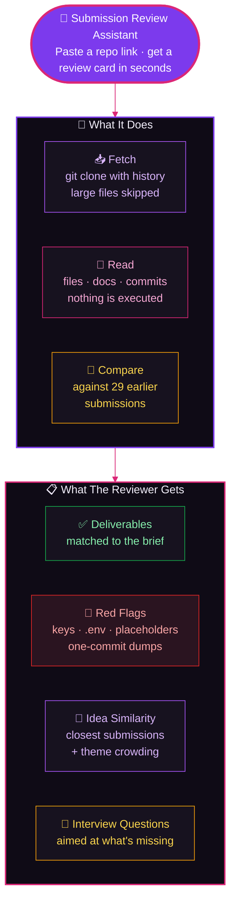
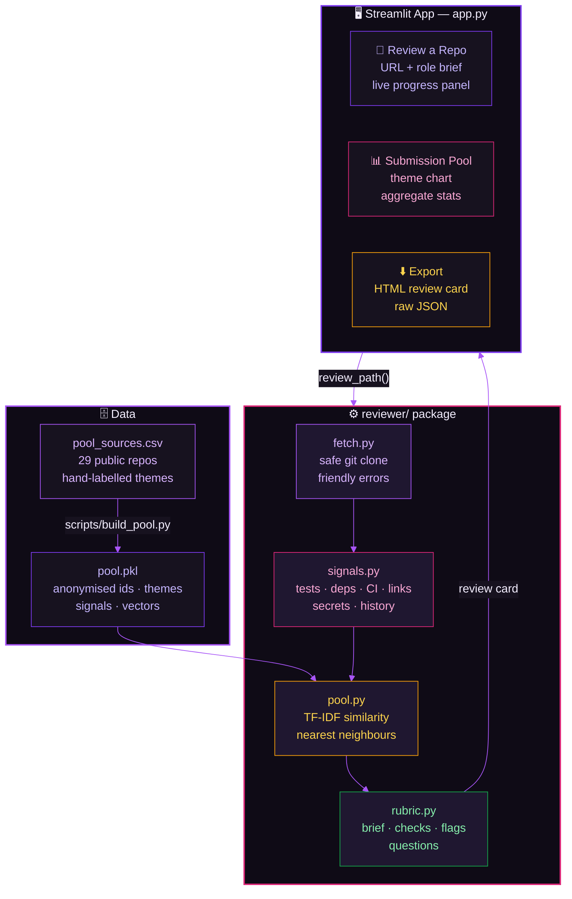
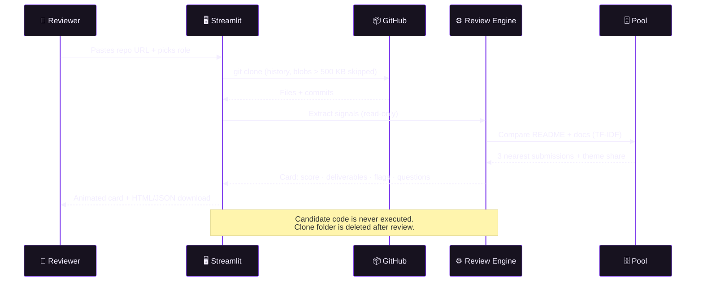

<div align="center">


<a href="https://cynbit-submission-reviewer.streamlit.app/" target="_blank">
  
</a>


&nbsp;

&nbsp;

&nbsp;

&nbsp;


&nbsp;

&nbsp;

&nbsp;


> 🎯 **Cynbit Technologies · AI/ML Engineer Intern Assessment — "Identify an AI Opportunity for Cynbit"**
> 41% of the public submissions to this assessment built the same lead-scoring tool. This project builds what Cynbit's reviewers — and Cynbit Studio — actually need: a fast, explainable first pass over every project submission.

</div>

<div align="center">

## 🚀 **[▶ TRY THE LIVE APP → cynbit-submission-reviewer.streamlit.app](https://cynbit-submission-reviewer.streamlit.app/)**

<a href="https://cynbit-submission-reviewer.streamlit.app/" target="_blank"></a>

**No login · No API key · Paste any public GitHub repo or click a demo repo**

</div>

## 📌 Quick Links

<div align="center">

| ❓ [Problem](#-problem-statement) | 💡 [Solution](#-solution) | 🏗️ [Architecture](#%EF%B8%8F-system-architecture) |
|:---:|:---:|:---:|
| 📊 [Evaluation](#-evaluation-on-real-data) | ⚡ [Features](#-features) | 🗂️ [Project Structure](#%EF%B8%8F-project-structure) |
| 🚀 [Run & Deploy](#-run--deploy) | 📄 [Reports](#-deliverables) | 🗺️ [Roadmap](#%EF%B8%8F-roadmap) |

</div>

## ❓ Problem Statement

<div align="center">

```
Cynbit hires constantly and runs technical assessments for several roles at once.
Every round produces dozens of GitHub repos, Figma files and Drive links, and a
senior engineer opens each one by hand: does it match the brief, does it run, is
it original? That time comes straight out of client delivery. Cynbit Studio and
BitElevate promise "AI code evaluation" and "verified proof of skill", which is
the same problem, at product scale.
```

</div>



```mermaid
%%{init: {'theme': 'base', 'themeVariables': {'primaryColor': '#17121F', 'primaryTextColor': '#F3EEFF', 'primaryBorderColor': '#7C3AED', 'lineColor': '#A855F7', 'secondaryColor': '#1F1730', 'background': '#0F0B16', 'mainBkg': '#17121F', 'clusterBkg': '#1F1730', 'titleColor': '#F3EEFF', 'edgeLabelBackground': '#17121F', 'fontFamily': 'monospace'}}}%%
flowchart LR
    subgraph POOL ["📥 What Arrives Every Round"]
        direction TB
        A["29 public repos found\nfor one assessment cycle\n(private + Drive not counted)"]
        B["41% build the same idea\nlead / inquiry triage"]
        C["55% arrive in one commit\n≥90% of files at once"]
    end

    subgraph COST ["⏳ What It Costs Reviewers"]
        direction TB
        D["Open, read, try to run\nevery single repo"]
        E["Inconsistent judgements\nacross reviewers"]
        F["Senior time pulled\naway from client work"]
    end

    POOL --> COST

    style A fill:#1F1730,stroke:#A855F7,color:#D8B4FE
    style B fill:#2A1420,stroke:#DB2777,color:#F9A8D4
    style C fill:#2A1E0F,stroke:#F59E0B,color:#FCD34D
    style D fill:#1F1730,stroke:#7C3AED,color:#C4B5FD
    style E fill:#1F1730,stroke:#7C3AED,color:#C4B5FD
    style F fill:#2A1420,stroke:#DB2777,color:#F9A8D4
    style POOL fill:#0F0B16,stroke:#DB2777,stroke-width:2px,color:#F3EEFF
    style COST fill:#0F0B16,stroke:#7C3AED,stroke-width:2px,color:#F3EEFF
```

| # | What I found in the real submission pool | Value |
|---|---|---|
| 🧲 | Submissions building **lead / inquiry triage** | **12 of 29 (41%)** |
| ⭐ | Submissions building **Revio review tools** | 6 of 29 (21%) |
| 📦 | Mostly **one commit** (≥90% of files at once) | 55% |
| 🌐 | Include a **live demo link** | 28% |
| 🎥 | Include a **walkthrough video** | 0% |
| 🧪 | Have **automated tests** | 72% |
| 📝 | Still contain **unfilled placeholder text** | 14% |
| 🔍 | Submissions that build a **submission reviewer** | **0** |

*Aggregates only. No individual candidate is scored or named in this repo. Full breakdown in [`reports/pool_insights.md`](reports/pool_insights.md).*

## 💡 Solution



It doesn't grade people. The **completeness score** says how much of the brief is present and runnable, so the reviewer's minutes go into judging the *thinking*, which no checklist can do. Every finding shows its evidence, and every flag is phrased as something to check, not a verdict.

**Two uses, one engine:**
- **Inside Cynbit (hiring):** a consistent first pass over every submission, plus ready-made interview questions.
- **Inside Cynbit Studio / BitElevate (product):** a "project proof" card that tells a learner what's complete and what to fix before applying.

## 🏗️ System Architecture



### 🔄 Review Lifecycle



## 📊 Evaluation on Real Data

Almost every submission to this assessment evaluates on **synthetic data**, since Cynbit's internal data is private. This problem has real data in public, so every number below comes from the 29 real submissions.

| What | Result |
|---|---|
| 📄 Deliverable detection on 25 AI/ML repos | **23 complete**; the 2 misses checked by hand and genuinely missing |
| 🧬 Idea recovery (leave-one-out nearest neighbour, 28 repos) | **57%** |
| 🧬 Same, with lead triage + proposal tools as one family | **71%** |
| 🔐 Secret scan | 1 false positive found on real data (a dummy test key), **fixed and regression-tested** |
| ⚡ Speed | **< 1 s** per repo after cloning |
| 🧪 Tests | **6 passing** |

> **Read the 57% honestly.** With 28 examples it's accurate to roughly ±15 points, and most misses fall between lead triage and proposal scoping, two themes that genuinely overlap. I tried other settings (README-only text, different weighting, k = 1/3/5); they ranged 50–71% with no consistent winner, so I kept the defaults rather than tune to 28 examples. That's why the card always shows the 3 closest submissions, not just a label.

## ✨ Features

<table>
<tr>
<td width="50%" valign="top">

### 🔗 Review a Repo
- Works on **any public GitHub repo**
- Live progress panel showing each real step
- Animated **completeness ring** (green / amber / red)
- Deliverables matched to the role brief

### 🚩 Red-Flag Scanner
- Committed **API keys**: OpenAI, Anthropic, Google, Groq, GitHub, AWS formats
- Dummy-value filter (no false alarm on `sk-test-…`)
- Committed `.env`, `node_modules/`, `venv/`
- Leftover template text: unfilled name fields, template usernames, to-do markers
- One-commit dumps, phrased as an interview question, not an accusation

</td>
<td width="50%" valign="top">

### 🧬 Idea Similarity
- TF-IDF over README + docs
- 3 nearest earlier submissions with similarity bars
- "X% of submissions share this theme"
- Pool stores **no README text**; words that appear in only one repo (like names) never enter the vocabulary

### 💬 Reviewer Output
- Interview questions chosen from the gaps
- **Downloadable HTML review card**, shareable and printable
- Raw JSON for any other tool
- Light and dark mode, animated cards, mobile-friendly

</td>
</tr>
</table>

## 📄 Deliverables

| Assessment asks for | Where it is |
|---|---|
| 📊 **AI Opportunity Report** | [`docs/AI_Opportunity_Report.md`](docs/AI_Opportunity_Report.md) |
| 🧪 **AI/ML Proof of Concept** | Streamlit app: [`app.py`](app.py) + [`reviewer/`](reviewer/) |
| 🛠️ **Technical Approach Report** | [`docs/Technical_Approach.md`](docs/Technical_Approach.md) |
| 📈 Pool insights | [`reports/pool_insights.md`](reports/pool_insights.md) |

## 🗂️ Project Structure

```
cynbit-submission-reviewer/
│
├── app.py                      # Streamlit UI: animated review card, pool tab, exports
├── .streamlit/config.toml      # Theme
├── packages.txt                # Installs git on Streamlit Cloud
├── requirements.txt
│
├── reviewer/
│   ├── fetch.py                # Safe git clone (history kept, large blobs skipped)
│   ├── signals.py              # Read-only evidence: files, docs, links, secrets, history
│   ├── pool.py                 # TF-IDF similarity vs the anonymised submission pool
│   ├── rubric.py               # Role briefs, checks, red flags, interview questions
│   ├── report_card.py          # Standalone HTML review card
│   └── review.py               # URL in → review card out
│
├── scripts/
│   └── build_pool.py           # Clones the pool, builds pool.pkl, writes reports/
│
├── data/
│   ├── pool_sources.csv        # 29 public repos + hand-labelled themes
│   └── pool.pkl                # Anonymised ids, themes, signals, vectors (no text)
│
├── docs/                       # AI Opportunity Report · Technical Approach
├── reports/                    # pool_insights.md · metrics.json
└── tests/                      # 6 pytest tests (built repos, dummy keys, similarity)
```

## 🚀 Run & Deploy

**No API keys needed.** The analysis runs locally with scikit-learn, and public repos are cloned anonymously.

### Run locally
```bash
git clone https://github.com/debasmita30/cynbit-submission-reviewer.git
cd cynbit-submission-reviewer
pip install -r requirements.txt
streamlit run app.py
```

### Rebuild the pool and metrics
```bash
python scripts/build_pool.py     # clones the 29 public repos, rewrites data/ and reports/
pytest -q
```

### Deploy on Streamlit Community Cloud
1. Sign in at [share.streamlit.io](https://share.streamlit.io) with GitHub
2. **Create app** → repo `cynbit-submission-reviewer` → branch `main` → file `app.py`
3. Deploy. No secrets required; `packages.txt` installs git

## 🛠️ Tech Stack

<div align="center">

| Layer | Technology | Purpose |
|---|---|---|
| **Language** | Python 3.10+ | Engine and app |
| **UI** | Streamlit + custom HTML/CSS/SVG | Animated cards, score ring, progress bars, light/dark |
| **ML** | scikit-learn (TF-IDF, cosine similarity) | Idea similarity, explainable and instant |
| **Data** | pandas | Tables, pool statistics |
| **Repo access** | git (partial clone) | History without heavy files, no API token |
| **Export** | Standalone HTML | Shareable review card |
| **Testing** | pytest | Real git repos built inside tests |
| **Hosting** | Streamlit Community Cloud | Free, deploys on push |

</div>

## 🛡️ Privacy & Fairness

- Reads **public repos only**; per-candidate cards are for reviewers, and published stats are aggregated and anonymised
- **Never executes** candidate code and **never auto-rejects**
- A live-demo link favours people who know free hosting, and the history check penalises people who squash commits. Both carry low weight and show up as questions, not verdicts
- Production version: retention period and deletion on request, in line with India's DPDP Rules

## 🗺️ Roadmap

> Honest next steps. The current app is fully functional without them.

- **Sandboxed execution**: Docker, no network, time limits; install, run tests, screenshot the app
- **LLM grader for written reports**: calibrated on 30–50 reviewer-scored submissions (target Spearman ≥ 0.6) before anyone sees a grade
- **Sentence embeddings + MinHash**: better idea matching and near-duplicate code detection
- **Figma / Drive / Vercel links**: beyond GitHub
- **Cynbit Studio integration**: learner-facing "project proof" cards

---

<div align="center">


**Cynbit Technologies · AI/ML Engineer Intern Assessment**

[](https://cynbit-submission-reviewer.streamlit.app/)

*Every submission, read in seconds. The decision stays human.*

</div>
